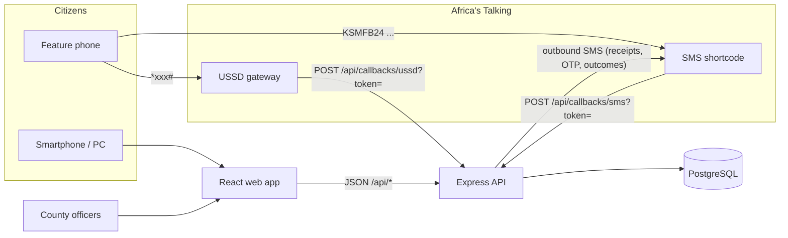
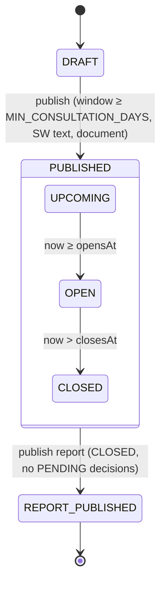

# Kenya Case Study: Public Participation Platform

> **Status:** design document for the MVP on branch `feat/kenya-mvp`.
> **Pilot:** Kisumu County (county code 042).

> **Legal note.** The mapping of law to features below is an engineering reading, not legal advice. Counsel must review it before any county relies on it, and every citation (articles, sections, case names, eKLR references) should be checked against the Kenya Law Reports and the current revised editions of each Act.

---

## 1. The problem

The Constitution of Kenya 2010 makes public participation a national value and requires it of Parliament, county assemblies and county executives. In practice it is often a formality:

- **Short notice.** Adverts for bills and budgets go out days before the forum, and sometimes after documents have been tabled.
- **Inaccessible documents.** Bills are published in English only, as large PDFs on a website or as hard copies at the county headquarters or the assembly.
- **Inconvenient forums.** Town halls run on weekdays during working hours, in a few venues, and people who travel there get no chance to speak.
- **No feedback.** Citizens hand in memoranda and never learn whether, or why, their views were taken into account.

The **Finance Bill 2024** protests (June–July 2024) showed the cost of this gap. Large numbers of mostly young Kenyans organised online, analysed the Bill clause by clause and demanded to be heard. Many said the formal participation process had not reflected their views. The Bill was ultimately withdrawn. Every county runs a similar process every year for its own Finance Bill, budget estimates, Annual Development Plan (ADP) and, every five years, its County Integrated Development Plan (CIDP).

This platform aims to make county participation **reachable** (any phone, both official languages), **timely** (enforced notice), and **accountable** (a recorded decision and reason for every submission, reported back to each participant).

---

## 2. Legal framework → platform features

| Provision | What it requires (summary) | Platform feature |
|---|---|---|
| Constitution Art. 1(2) | The people may exercise sovereignty directly or through elected representatives | Direct submissions on bills and budgets by any citizen |
| Art. 7 | Kiswahili is the national language; Kiswahili and English are official; the State must promote Kenyan Sign Language and indigenous languages (7(3)(b)) | Every citizen-facing string exists in EN and SW (`i18n.ts`). A consultation cannot be published without a Kiswahili title and summary. KSL is a roadmap item (§6) |
| Art. 10(2)(a) | National values include democracy and participation of the people | Core purpose |
| Art. 33 | Freedom of expression, with limits (hate speech, incitement) | Free-text submissions. Moderation policy is an open item (§6) |
| Art. 35 | Right of access to information held by the State | Full document link required to publish. Public feedback report. Public receipt lookup |
| Art. 118(1)(b) | Parliament must facilitate public participation in its legislative business | National consultations (`countyId = null`, admin-managed) |
| Art. 174(c), (d) | Objects of devolution: self-governance and participation of the people; recognising communities' right to manage their own affairs | County-scoped consultations and ward-level issues |
| Art. 184(1)(c) | Legislation on urban areas and cities must provide for residents' participation | Ward/sub-county structure supports urban wards (e.g. Kisumu Central) |
| Art. 196(1)(b) | County assemblies must facilitate public participation in legislative and other business | County-assembly consultations on bills |
| Art. 201(a) | Openness, accountability and public participation in financial matters | Consultation types `FINANCE_BILL`, `BUDGET_ESTIMATES`, `ADP`, `CIDP` |
| Art. 232(1)(d) | Public service values include involving people in policy-making | Officer responses to ward issues. Decisions with reasons |
| County Governments Act 2012, ss. 87–92 | Principles of citizen participation (timely access to information, reasonable access to the process, feedback, protection of minorities); citizens' rights to petition; s. 91 requires counties to set up participation modalities and platforms, including ICT-based ones, town hall meetings and notice boards | The platform itself is an ICT-based s. 91 platform. The feedback loop (§3.4) serves the feedback principle |
| Public Finance Management Act 2012, s. 125 | Stages of the county budget process, including participation | Budget/ADP/CIDP consultation types |
| PFM Act 2012, s. 137 | County Budget and Economic Forum (CBEF) as a consultation forum on budget matters | Roadmap: CBEF members as a reviewer role. Reports shareable with the CBEF |
| Access to Information Act 2016 | Proactive disclosure of information by public entities | Public reports and issue timelines, with open-data export on the roadmap |
| Data Protection Act 2019 | Registration with the Office of the Data Protection Commissioner (ODPC), lawful processing, data minimisation, a data protection impact assessment (DPIA) for high-risk processing, data-subject rights | Phone is the only identifier. No national ID collected. Reports strip names and phones. A DPIA and ODPC registration are pilot prerequisites (§5) |

### Case law on "meaningful" participation

- **Robert N. Gakuru & others v Governor, Kiambu County & 3 others [2014] eKLR.** The High Court struck down a county Finance Act because participation had been inadequate. Participation must be real, not a formality, and the public must be given adequate notice and the opportunity to be heard.
- **Mui Coal Basin Local Community & 15 others v Permanent Secretary, Ministry of Energy & 17 others [2015] eKLR.** Sets out principles that courts widely cite: participation must be meaningful and accessible to those affected, it must give the public effective notice and enough information, it should use a range of mechanisms, and it does not require that every view be adopted.
- **British American Tobacco Kenya plc v Cabinet Secretary for Health & others [2019] eKLR (Supreme Court).** Sets out guiding principles of public participation. These include that it applies to all public decision-making, that it must be real and not illusory, that it requires access to information, and that the decision-maker must show it took the public's views into account.

What the platform takes from these cases: **notice**, **access to the document**, **reachable channels** and **evidence that views were considered** are what courts examine. That evidence is a decision and a reason recorded for each submission.

### Pending legislation

A **Public Participation Bill** has been before Parliament in successive sessions to set a national framework (minimum standards, notice periods, reporting). Check its current status before relying on any specific requirement. If it is enacted, `MIN_CONSULTATION_DAYS` and the report format may need to follow it.

---

## 3. Design principles

### 3.1 Reach
- **USSD** works on any phone without data or a smartphone. **SMS** handles keyword submissions and all notifications. The **web** app serves smartphones and county officers.
- Kiswahili and English are available everywhere. A citizen's language preference is stored and used for every message sent to them (USSD option 5 toggles it).
- Sign-in uses a phone number and a one-time SMS code, with no password or email. Numbers are normalised to E.164: `07…`, `01…`, `+254…` and `254…` are all accepted.

### 3.2 Adequate notice
- Publishing fails if the window between `opensAt` and `closesAt` is shorter than **`MIN_CONSULTATION_DAYS`** (default 14), or if the closing date has passed.
- The 14-day default is **policy, not a statutory number**. Each county should set it in its participation regulations.

### 3.3 Access to the document
- Publishing also requires the full document (`documentUrl`) and a plain-language **summary in both languages**.
- Published consultations cannot be edited, so citizens comment on a fixed text.

### 3.4 The feedback loop
- Every submission gets a **reference** (e.g. `S-7KQ2MX`), sent to the citizen by SMS. References avoid 0/O/1/I so they can be read aloud.
- Officers record a decision on each submission (`ADOPTED`, `PARTIALLY_ADOPTED`, `NOT_ADOPTED`). They can decide many submissions at once, grouped by theme.
- A **reason is mandatory** for anything not fully adopted.
- The report cannot be published until the consultation has **closed** and **every submission has a decision**.
- Publishing the report sends **every participant an SMS** with their own outcome and a link to the report.
- Anyone can look up a reference at any time on the web, by USSD (option 3) or by SMS (`STATUS`/`HALI`).

### 3.5 County scoping
- `OFFICER` users are bound to one county and can manage only that county's consultations and issues. `ADMIN` users manage national items.
- Drafts are invisible to the public.
- Anyone can comment on any county's consultations, including people who work there or live in the diaspora. The submitter's ward is recorded so the report can break down responses geographically.

### 3.6 Privacy (Data Protection Act 2019)
- The phone number is the only identifier. **No national ID number is collected.** A name is optional.
- Public reports and issue listings **exclude names, phone numbers and reporter IDs**. The report shows only ward and sub-county.
- OTPs are stored as HMAC hashes, expire after 5 minutes, allow at most 5 attempts and are rate-limited to 3 per 15 minutes.

### 3.7 Auditability
- Publishing, decisions, offline submissions recorded by officers, report publication and issue responses are written to `AuditLog` with the actor, the entity and metadata. This record of how views were handled is what a court would ask for.

---

## 4. Architecture



| Component | Tech | Notes |
|---|---|---|
| API | Node 18+, Express, Zod, Prisma | `apps/api`. JWT bearer auth (7-day expiry) |
| Database | PostgreSQL 16 | `docker compose up -d db` |
| SMS/USSD | Africa's Talking | `SMS_PROVIDER=console` logs messages locally. AT callbacks are unsigned, so callback URLs carry a shared `CALLBACK_TOKEN`. In production, also restrict them to AT's IP ranges |
| Web | React (Vite) | `apps/web` |

Outbound SMS is fire-and-forget, so a failed SMS never fails the citizen's submission.

### 4.1 Data model (summary)

- **County** (id = official code 1–47) → **SubCounty** → **Ward**. All 47 counties are seeded. Wards are loaded per county as it onboards.
- **User**: phone (unique), optional name, role (`CITIZEN`/`OFFICER`/`ADMIN`), language (`EN`/`SW`), ward, and county (officers only).
- **Consultation**: SMS `code` (e.g. `KSMFB24`), type (`BILL`, `FINANCE_BILL`, `BUDGET_ESTIMATES`, `CIDP`, `ADP`, `POLICY`, `OTHER`), county (null for national), EN/SW title and summary, document URL, open/close dates, status, report summary.
- **Submission**: reference, channel (`WEB`/`SMS`/`USSD`, plus `PAPER`/`FORUM` for officer-digitised offline input), stance (`SUPPORT`/`OPPOSE`/`AMEND`/`GENERAL`), optional clause, body, ward at time of submission, decision, reason, decider. The submitter is optional, because a paper memorandum may come without a phone number. `recordedBy` names the officer who digitised it.
- **Issue**: reference, ward, category (`WATER`, `ROADS`, `HEALTH`, `EDUCATION`, `SECURITY`, `WASTE`, `OTHER`), status (`OPEN` → `ACKNOWLEDGED` → `IN_PROGRESS` → `RESOLVED`/`REJECTED`), channel, upvote count. Has **IssueUpvote** (one per user) and **IssueUpdate** (public officer notes, with status changes sent to the reporter by SMS).
- **OtpCode**, **AuditLog**.

### 4.2 Consultation state machine



Only `DRAFT`, `PUBLISHED` and `REPORT_PUBLISHED` are stored. `UPCOMING`, `OPEN` and `CLOSED` are derived from the dates (`phaseOf`), so no scheduler is needed. Citizens can submit only in `OPEN`. Officers can still record `PAPER`/`FORUM` submissions in `CLOSED`, because memoranda delivered on time are often digitised later, but not after the report is published.

### 4.3 USSD menu

Africa's Talking sends the whole input path on each request (`text="1*1*2*comment"`), so the menu is a pure function of that path. Screens are capped at 182 characters.

```
CON Public Participation / Ushiriki wa Umma
1. Open consultations ── list (≤5, closing soonest; county + national)
│                        └─ pick → 1 Support 2 Oppose 3 Propose a change 4 General
│                                  └─ type comment → END "Thank you! Ref: S-XXXXXX" (+ SMS receipt)
2. Report a ward issue ── (needs ward) category 1–7 → describe → END "Ref: I-XXXXXX"
3. Check a reference ──── enter S-/I- ref (dash optional) → END status / decision + reason
4. Set my ward ────────── county code 1–47 → sub-county → ward → END "Ward set: …"
5. Kiswahili / English ── toggles and saves language
```

A user without a ward who picks option 1 is told to set their ward first if there is nothing national to show. A `*` typed inside a comment is rejoined, so it is not lost.

### 4.4 SMS keyword grammar

```
<CODE> [stance] <comment>     e.g.  KSMFB24 HAPANA Ada za soko ni kubwa
   stance ∈ YES|SUPPORT|NDIO → SUPPORT
             NO|OPPOSE|HAPANA → OPPOSE
             AMEND|CHANGE|BADILISHA → AMEND
             (omitted)        → GENERAL
STATUS <ref> | HALI <ref>     reference lookup
HELP | MSAADA                 usage
```

Codes are case-insensitive. An unknown or closed code gets the help text in reply.

### 4.5 API surface (abridged)

`POST /api/auth/otp/request|verify` · `GET|PATCH /api/me` · `GET /api/counties[/:id]` ·
`GET|POST /api/consultations` · `PATCH /api/consultations/:id` · `POST …/:id/publish` ·
`POST|GET …/:id/submissions` · `POST …/:id/submissions/offline` · `POST …/:id/decisions` · `GET|POST …/:id/report` ·
`GET /api/me/submissions` · `GET /api/submissions/:reference` ·
`GET|POST /api/issues` · `GET /api/issues/:id` · `POST …/:id/upvote` · `POST …/:id/updates` ·
`POST /api/callbacks/ussd|sms`

---

## 5. Kisumu pilot

**Why one county first.** Participation is mostly a county function. A single county gives one assembly clerk, one set of officers and one budget calendar to design around, and makes before/after comparison possible. Kisumu combines a dense urban core (Kisumu Central) with rural and peri-urban sub-counties (Nyando, Nyakach, Muhoroni, Seme), so it exercises both web and USSD use.

**Seeded geography.** 7 sub-counties (matching the constituencies) and 35 wards:

| Sub-county | Wards |
|---|---|
| Kisumu Central | Railways, Migosi, Shaurimoyo Kaloleni, Market Milimani, Kondele, Nyalenda B |
| Kisumu East | Kajulu, Kolwa East, Manyatta B, Nyalenda A, Kolwa Central |
| Kisumu West | South West Kisumu, Central Kisumu, Kisumu North, West Kisumu, North West Kisumu |
| Seme | West Seme, Central Seme, East Seme, North Seme |
| Nyando | East Kano/Wawidhi, Awasi/Onjiko, Ahero, Kabonyo/Kanyagwal, Kobura |
| Muhoroni | Miwani, Ombeyi, Masogo/Nyang'oma, Chemelil, Muhoroni/Koru |
| Nyakach | South West Nyakach, North Nyakach, Central Nyakach, West Nyakach, South East Nyakach |

Verify the names and spelling against the IEBC gazette before launch (`apps/api/prisma/geo-data.ts`).

### Rollout steps

1. **Agreement with the county.** Sign an MoU with the County Assembly (Clerk, relevant committees) and the County Executive's public participation/civic education office. Create `OFFICER` accounts.
2. **Compliance.** Complete a DPIA and register the controller/processor with the ODPC. Publish a privacy notice in EN and SW. Agree a retention period.
3. **Telecoms.** Register a USSD code and an SMS shortcode with Africa's Talking. Agree who bears costs, ideally a zero-rated or reverse-billed shortcode (§6). Set a sender ID.
4. **First consultation.** Choose a real, time-bound item, for example the annual county Finance Bill or the ADP. Officers draft the bilingual summary.
5. **Sensitisation.** Use ward administrators, chiefs' barazas, churches and mosques, market associations, boda boda and youth groups, and local radio, including Dholuo-language vernacular stations. Use posters at ward offices showing the USSD code and SMS keyword.
6. **Offline inputs.** Officers digitise memoranda delivered on paper and views raised at physical forums as `PAPER`/`FORUM` submissions. These go through the same decision and report pipeline. If a phone number is given, the citizen gets an SMS receipt and their outcome.
7. **Report and review.** Publish the feedback report, notify participants and hold a review with the county.

### Success metrics

| Metric | Source |
|---|---|
| Submissions per 1,000 residents, by ward | `Submission.wardId` against KNBS census ward populations |
| Share of submissions by USSD/SMS vs web | `Submission.channel` |
| Share of submissions with a recorded decision | `Submission.decision ≠ PENDING` |
| Days from close to report publication | `closesAt` → `reportPublishedAt` |
| Unique participants; repeat participants across consultations | `Submission.userId` |
| Issue response time and resolution rate, by ward and category | `IssueUpdate`, `Issue.status` |

Set baselines from the county's previous manual process where records exist.

---

## 6. Risks and open questions

- **SMS cost.** Premium or standard-rate SMS deters participation. A zero-rated or reverse-billed shortcode is needed, and someone (the county, a donor or the assembly) has to fund outbound receipts and outcome notifications at scale.
- **Identity and astroturfing.** One phone is not one person. SIM registration helps traceability but is not proof of identity, and organised campaigns can flood a consultation. Treat counts as signal, not votes, and report unique participants alongside totals. Consider duplicate-text detection and flagging bursts from a single source.
- **Accessibility.** The web app should meet WCAG 2.1 AA and work with screen readers. Persons with disabilities need assisted channels. Kenyan Sign Language (Art. 7(3)(b)) needs video summaries for major consultations. USSD sessions time out, which is hard for some users, so SMS must stay available as a fallback.
- **Digital divide.** The platform **complements** physical forums and does not replace them. Courts look at the whole process. Offline inputs flow into the same decision and report pipeline (`PAPER`/`FORUM` channels).
- **Low literacy and local languages.** USSD text is still text. Voice/IVR in Dholuo and other local languages is on the roadmap.
- **Moderation.** Free text may include hate speech or incitement (Art. 33(2); the National Cohesion and Integration Act and the NCIC's mandate). A moderation policy, a review queue and an appeal path are needed, and moderation itself must be auditable so it is not used to suppress dissent.
- **Data retention.** Decide how long phones, submissions and OTP rows are kept, and how data-subject requests are handled. OTP rows are not yet purged.
- **Election periods.** Ward-level issue data and participant lists are politically sensitive. Restrict officer exports, and consider pausing some features or adding extra review around elections.
- **Reference data.** Ward names and boundaries come from IEBC and change with boundary reviews. Verify them before each county onboards.
- **Callback security.** Africa's Talking callbacks are unsigned. The shared token and IP allowlist reduce, but do not remove, spoofing risk.
- **Legal reliance.** If the Public Participation Bill is enacted, its standards may override MVP defaults. Counsel should review the platform's rules annually.

---

## 7. Roadmap beyond the MVP

1. **Offline intake, part 2.** Attach a scan of each paper memorandum, and record forum attendance registers.
2. **Voice/IVR** in Kiswahili, English and local languages, starting with Dholuo for Kisumu, so listeners hear the summary and record a comment.
3. **WhatsApp** channel through the same keyword grammar.
4. **Theme clustering.** Group similar submissions to speed up bulk decisions, with an officer always confirming.
5. **Budget tracker.** Link ADP/budget projects to the ward issues they address, and show citizens whether a project they raised was funded and delivered.
6. **Open data.** CSV/JSON export of reports and anonymised submissions, in line with the Access to Information Act.
7. **CBEF and assembly committee roles** for reviewing submissions before the report.
8. **National rollout** to all 47 counties, loading each county's wards from the IEBC gazette, with per-county configuration (notice period, sender ID, languages).
